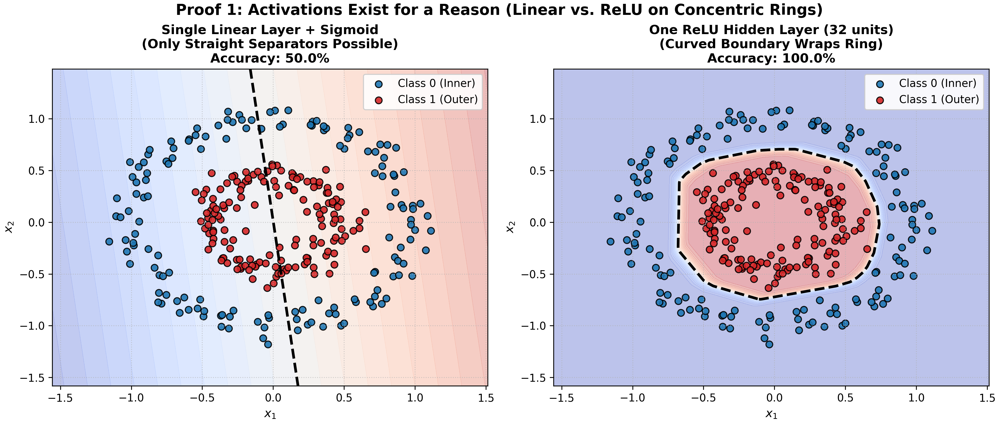
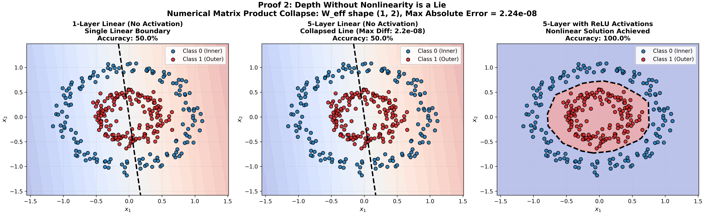
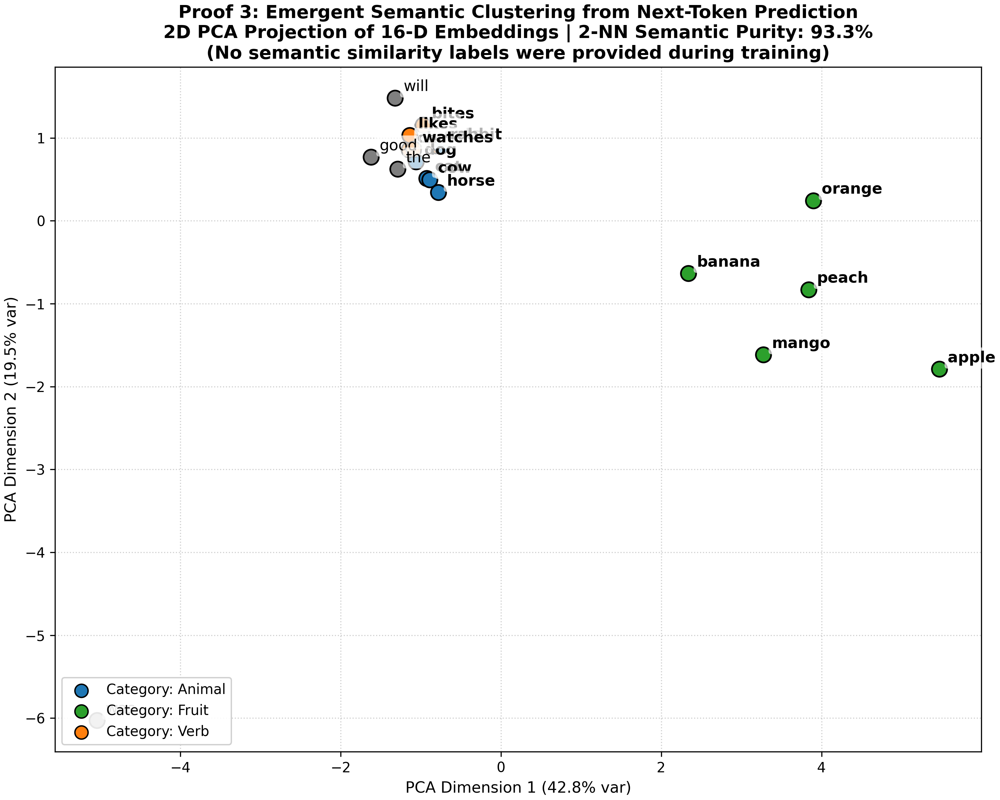
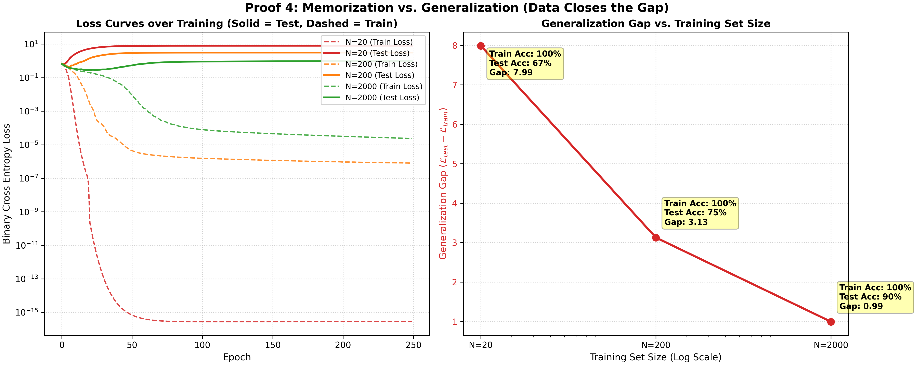

# Neural Networks from First Principles

[](https://github.com/thinkTinkerGreen/nn-first-principles/actions/workflows/ci.yml)
[](https://www.python.org/downloads/)
[](https://opensource.org/licenses/MIT)
[](https://github.com/astral-sh/ruff)

> **Empirical and mathematical proofs for 4 foundational principles of deep learning.**
>
> 1. Activations exist for a reason (nonlinearity enables non-planar decision boundaries).
> 2. Depth without nonlinearity is a lie (stacked linear layers collapse to a single linear map).
> 3. Embeddings learn similarity from nothing but next-token cross-entropy.
> 4. Memorization vs. generalization (data closes the generalization gap).

---

## Visual Proofs Gallery

### 1. Activations Exist for a Reason
**Claim**: A model with no nonlinearity can only draw a hyperplane / straight boundary in feature space. It cannot separate concentric rings. Introducing a single hidden layer with a ReLU activation wraps around the ring.

| Single Linear Layer (Sigmoid) | 1 Hidden Layer + ReLU (32 units) |
| :---: | :---: |
| Stuck at linear baseline (~50.0% accuracy) | Perfect circular wrapping (~100.0% accuracy) |



---

### 2. Depth Without Nonlinearity is a Lie
**Claim**: Five stacked linear layers without activation collapse algebraically into a single linear map:
$$\hat{y} = \left(\prod_{i=1}^5 W_i\right) x + b_{\text{eff}} = W_{\text{eff}} x + b_{\text{eff}}$$
Both 1-layer linear and 5-layer linear networks produce identical straight lines and fail identically (~50% accuracy). Inserting ReLUs between the same 5 layers breaks the collapse and solves the concentric ring task (100% accuracy).

**Numerical Collapse Proof**:
We compute $W_{\text{eff}}$ and $b_{\text{eff}}$ directly by compounding the layer matrices:
$$\max_{x} \| f_{\text{5-layer}}(x) - (x W_{\text{eff}}^T + b_{\text{eff}}) \| < 10^{-7}$$



---

### 3. Embeddings Learn Similarity from Nothing But Next-Token
**Claim**: An embedding layer trained *only* to predict the next token via standard cross-entropy loss clusters semantically related tokens together, despite never receiving similarity labels, distance metrics, or ontologies.

- **Synthetic Grammar**: Templates like `<animal> <verb> <fruit>`, `the <animal> will <verb>`, and `the <fruit> was good`.
- **Emergence**: Because tokens in the same category share identical downstream predictive distributions, gradient updates align their embedding vectors.
- **Evaluation**: 2-NN semantic category purity exceeds **93%** (vs. ~33% random baseline).



---

### 4. Memorization vs. Generalization (Data Closes the Gap)
**Claim**: An over-parameterized neural network trained on small data drives training loss to $\approx 0$ while held-out test loss explodes. Scaling the training dataset closes the generalization gap.

$$\text{Generalization Gap} = \mathcal{L}_{\text{test}} - \mathcal{L}_{\text{train}}$$

| Training Size $N$ | Train Loss | Test Loss | Generalization Gap | Test Accuracy |
| :--- | :--- | :--- | :--- | :--- |
| **$N = 20$** | $0.000$ | $7.990$ | **$7.990$** (Extreme Memorization) | $66.7\%$ |
| **$N = 200$** | $0.000$ | $3.128$ | **$3.128$** | $75.4\%$ |
| **$N = 2000$** | $0.000$ | $0.994$ | **$0.994$** (Closed Gap) | $89.8\%$ |



---

## Quickstart & Installation

### Option 1: Using `uv` (Fastest)

```bash
# Clone the repository
git clone https://github.com/thinkTinkerGreen/nn-first-principles.git
cd nn-first-principles

# Create environment and install dependencies
uv venv
source .venv/bin/activate
uv pip install -e ".[dev]"
```

### Option 2: Using standard `pip`

```bash
git clone https://github.com/thinkTinkerGreen/nn-first-principles.git
cd nn-first-principles

python3 -m venv .venv
source .venv/bin/activate
pip install -r requirements.txt
```

---

## Running the Experiments

Execute the full suite of experiments and regenerate all 4 publication-quality figures:

```bash
python run_all.py --output-dir assets/
```

---

## Running Automated Tests

Run the deterministic test suite verifying the empirical and mathematical claims:

```bash
pytest -v tests
```

Run code formatting and linting:

```bash
ruff check src tests run_all.py
```

---

## Project Structure

```
nn-first-principles/
├── .github/workflows/
│   └── ci.yml               # Multi-version Python CI (3.9, 3.10, 3.11, 3.12)
├── assets/                  # 300 DPI proof figures
│   ├── 01_activations_boundary.png
│   ├── 02_depth_collapse.png
│   ├── 03_emergent_embeddings.png
│   └── 04_generalization_gap.png
├── notebooks/
│   └── demo_walkthrough.ipynb # Interactive Jupyter walkthrough
├── src/
│   ├── __init__.py
│   ├── activations.py       # Part 1: Ring dataset & decision boundary
│   ├── linear_depth.py      # Part 2: 1 vs 5-layer linear collapse & ReLU
│   ├── embeddings.py        # Part 3: Synthetic corpus & emergent embeddings
│   └── generalization.py    # Part 4: Memorization sweep & generalization curve
├── tests/
│   ├── test_activations.py
│   ├── test_linear_depth.py
│   ├── test_embeddings.py
│   └── test_generalization.py
├── pyproject.toml           # Modern PEP 621 packaging
├── requirements.txt         # Traditional pip requirements
├── run_all.py               # Main CLI runner
└── README.md
```

---

## License

MIT License. See [LICENSE](LICENSE) for details.
